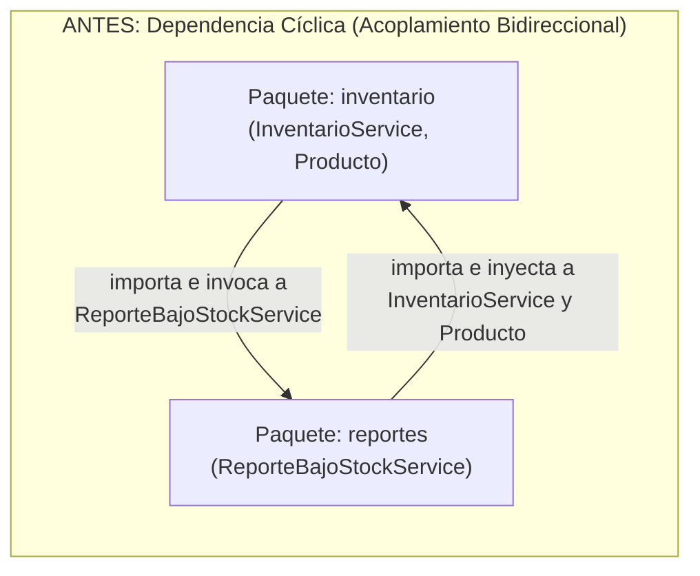

# Post-contenido — Refactorización Guiada por Pruebas: Code Smells, Paquetes y Acoplamiento en un Proyecto Java Real

**Unidad 11 · Patrones de Diseño de Software**  
**Proyecto:** `refactoring-u11` (`com.universidad.refactoringu11`)  
**Stack:** Java 17 · Spring Boot 3.x · Maven 3.9+ · JUnit 5 · ArchUnit 1.3.0

## Parte 1: Red de Seguridad y Refactorización Guiada por Evidencia

### 1. Objetivo de la Parte 1
Escribir pruebas de caracterización que documenten el comportamiento actual de un código con *code smells* reales antes de modificarlo, y aplicar de forma autónoma la técnica de refactorización de Martin Fowler correspondiente a cada *smell* identificado, verificando con las mismas pruebas que el comportamiento observable del sistema no cambia.

### 2. Diagnóstico y Evidencia Cuantitativa Antes vs. Después (Parte 1)

#### 2.1. Code Smell 1: *Long Method* (Bloater) en `InventarioService.actualizarInventario()`
- **Diagnóstico inicial:** El método `actualizarInventario(Long, int, String)` tenía **38 líneas en su cuerpo** (más de 45 líneas contando firma y espacios) y una **complejidad ciclomática (CC) de 7**, mezclando **5 responsabilidades distintas** en un único bloque monolítico:
  1. Validación de parámetros de entrada (`productoId`, `cantidad`, `tipoMovimiento`).
  2. Búsqueda secuencial del producto en la colección interna.
  3. Cálculo y actualización del stock (con verificación de saldo insuficiente en salidas).
  4. Cálculo de la cantidad de reorden cuando el stock cae por debajo del mínimo (`stockMinimo * 3 - nuevoStock`).
  5. Registro de auditoría en el historial de movimientos y notificación/retorno de alerta de bajo stock.
- **Técnica de Fowler elegida:** **Extract Method** (Composición de Métodos) combinada con **Replace Nested Conditional with Guard Clauses** (Cláusulas de Guarda).

| Métrica / Indicador | Antes de Refactorizar (Paso 1) | Después de Refactorizar (Paso 3) | Mejora Obtenida |
| :--- | :--- | :--- | :--- |
| **Líneas de `actualizarInventario()`** | 38 líneas de cuerpo (>35 líneas) | **8 líneas** de cuerpo (<= 10 líneas) | Reducción del **78.9%** en longitud del método |
| **Responsabilidades en `actualizarInventario()`** | 5 responsabilidades mezcladas | **1 responsabilidad** (orquestación de alto nivel) | Separación en 6 métodos privados cohesivos (SRP) |
| **Complejidad Ciclomática (CC) de `actualizarInventario()`** | CC = 7 | **CC = 4** (solo cláusulas de guarda planas) | Reducción de ramificación anidada; CC <= 3 en cada método extraído |
| **Pruebas de caracterización (`InventarioServiceTest`)** | 6 tests en verde (sin modificar) | **6 tests en verde (sin modificar)** | 100% de preservación del comportamiento observable |

**Métodos privados extraídos con responsabilidad única:**
- `esMovimientoValido(Long, int, String)`: valida precondiciones de entrada.
- `buscarProductoPorId(Long)`: localiza el producto en memoria.
- `tieneStockSuficiente(Producto, int, String)`: verifica disponibilidad antes de descontar stock.
- `aplicarMovimientoStock(Producto, int, String)`: calcula y actualiza el nuevo stock del producto.
- `calcularCantidadReorden(Producto, int)`: calcula cuántas unidades deben reordenarse si cae bajo el mínimo.
- `registrarMovimiento(Producto, int, String, int)`: registra la trazabilidad de auditoría.
- `generarRespuestaActualizacion(Producto, int)`: evalúa si requiere alerta de reorden y formatea el código de retorno.

#### 2.2. Code Smell 2: *Switch Statements* Duplicados en `ClasificadorProducto` y `EtiquetadoProducto`
- **Diagnóstico inicial:** Tanto `ClasificadorProducto.calcularRecargoEnvio(Producto)` como `EtiquetadoProducto.generarEtiqueta(Producto)` contenían exactamente la misma estructura `switch (producto.getTipo())` con las mismas **4 ramas (`LIBRO`, `ELECTRONICO`, `ROPA`, `ALIMENTO`)** y el mismo bloque `default`. Esta **duplicación estructural del 100%** sobre el tipo de producto provocaba además *Shotgun Surgery*: añadir un nuevo tipo obligaba a buscar y modificar manualmente ambas clases.
- **Técnica de Fowler elegida:** **Replace Conditional with Polymorphism** (Reemplazar Condicional con Polimorfismo) mediante métodos abstractos implementados por cada constante en el `enum TipoProducto`.

| Métrica / Indicador | Antes de Refactorizar (Paso 1) | Después de Refactorizar (Paso 4) | Mejora Obtenida |
| :--- | :--- | :--- | :--- |
| **Sentencias `switch` / `if-else` sobre `TipoProducto`** | 2 bloques `switch` (4 `case` + `default` cada uno) | **0 bloques `switch` / `if-else`** en todo el proyecto | Eliminación del **100%** de condicionales de tipo |
| **Porcentaje de duplicación estructural del condicional** | **100%** (misma estructura repetida en 2 clases) | **0%** (delegación polimórfica de 1 línea) | Cumplimiento estricto del principio Open/Closed (OCP) |
| **Complejidad Ciclomática en `calcularRecargoEnvio` y `generarEtiqueta`** | CC = 5 en cada método (10 en total) | **CC = 1** en cada método (2 en total) | Reducción del **80%** en complejidad ciclomática |
| **Líneas de cuerpo en `calcularRecargoEnvio` y `generarEtiqueta`** | 9 líneas por método | **1 línea** por método (`return producto.getTipo()...`) | Delegación directa con firma pública intacta |
| **Clases a modificar al agregar un nuevo `TipoProducto`** | 3 clases (`TipoProducto`, `ClasificadorProducto`, `EtiquetadoProducto`) | **1 sola clase** (`TipoProducto`) | Eliminación de *Shotgun Surgery* |

### 3. Resultado de `mvn test` Antes y Después de Cada Refactorización (Parte 1)

| Momento de Ejecución | Comando Ejecutado | Tests Ejecutados | Fallos / Errores | Estado de las Pruebas |
| :--- | :--- | :--- | :--- | :--- |
| **Paso 2:** Red de seguridad sobre código original (sin refactorizar) | `mvn test` | 14 (`InventarioServiceTest`: 6, `ClasificadorProductoTest`: 4, `EtiquetadoProductoTest`: 4) | `Failures: 0, Errors: 0` | `BUILD SUCCESS` (Verde) |
| **Paso 3:** Tras eliminar el *Long Method* en `InventarioService` | `mvn test` | 14 (0 líneas de test modificadas) | `Failures: 0, Errors: 0` | `BUILD SUCCESS` (Verde) |
| **Paso 4:** Tras eliminar los *Switch Statements* con Polimorfismo | `mvn test` | 14 (0 líneas de test modificadas) | `Failures: 0, Errors: 0` | `BUILD SUCCESS` (Verde) |

```text
[INFO] -------------------------------------------------------
[INFO]  T E S T S
[INFO] -------------------------------------------------------
[INFO] Running com.universidad.refactoringu11.inventario.ClasificadorProductoTest
[INFO] Tests run: 4, Failures: 0, Errors: 0, Skipped: 0
[INFO] Running com.universidad.refactoringu11.inventario.EtiquetadoProductoTest
[INFO] Tests run: 4, Failures: 0, Errors: 0, Skipped: 0
[INFO] Running com.universidad.refactoringu11.inventario.InventarioServiceTest
[INFO] Tests run: 6, Failures: 0, Errors: 0, Skipped: 0
[INFO] 
[INFO] Results:
[INFO] 
[INFO] Tests run: 14, Failures: 0, Errors: 0, Skipped: 0
[INFO] ------------------------------------------------------------------------
[INFO] BUILD SUCCESS
[INFO] ------------------------------------------------------------------------
```


## Parte 2: Diagnóstico y Resolución de Acoplamiento entre Paquetes

### 1. Diagnóstico del Ciclo de Dependencias con ArchUnit (Paso 2 — Prueba en Rojo)

Al integrar el módulo `reportes` (`ReporteBajoStockService`) e invocarlo directamente desde `InventarioService`, las 14 pruebas de negocio de la Parte 1 continúan pasando en verde, pero se introduce una **dependencia cíclica bidireccional entre paquetes (`inventario <-> reportes`)**:



### Decisión de Diseño 3: Ubicación de la interfaz `NotificadorBajoStock` en el paquete `inventario` vs. `reportes`

- **Principio aplicado:** Principio de Inversión de Dependencias (*Dependency Inversion Principle* - DIP) y regla de dirección de dependencias entre capas ("los paquetes de infraestructura/soporte dependen de dominio; el dominio nunca depende de infraestructura").
- **Decisión tomada:** Se ubicó la interfaz `NotificadorBajoStock` dentro del paquete **`com.universidad.refactoringu11.inventario`** (paquete de mayor nivel de abstracción) y no en `com.universidad.refactoringu11.reportes`.
- **Justificación técnica:**
  1. **Nivel de abstracción y propiedad del contrato (Ownership):** Entre ambos paquetes, **`inventario` es el paquete de mayor nivel de abstracción** porque encapsula las entidades y reglas esenciales del negocio (`Producto`, `TipoProducto`, control de existencias y cálculo de reorden en `InventarioService`). En cambio, **`reportes` es un módulo consumidor/secundario de menor nivel** encargado de formatear salidas y consolidar reportes a partir del estado del inventario.
  2. **Por qué colocarla en `reportes` no rompería el ciclo:** Si `NotificadorBajoStock` se declarara dentro de `reportes`, `InventarioService` tendría que seguir escribiendo `import com.universidad.refactoringu11.reportes.NotificadorBajoStock;`. Como en Java la unidad de acoplamiento de paquetes se determina por los tipos importados entre paquetes, `inventario` seguiría dependiendo de `reportes` y `reportes` seguiría dependiendo de `inventario` (porque usa `Producto` e `InventarioService`), manteniendo vivo el ciclo detectado por ArchUnit.
  3. **Inversión real de la flecha de dependencia:** Al situar `NotificadorBajoStock` en `inventario`, el dominio define el contrato ("necesito notificar cuando un `Producto` entra en bajo stock") sin conocer quién lo implementa. `ReporteBajoStockService` en `reportes` implementa esa interfaz, logrando que todas las flechas de dependencia entre paquetes apunten en una única dirección acíclica: **`reportes -> inventario`**.

  ### Decisión de Diseño 4: Granularidad del método en `NotificadorBajoStock` (Evento individual vs. Notificación por lote)

- **Firma elegida:** `void notificar(Producto producto, int cantidadReorden);` (notificación por evento individual inmediato).
- **Alternativa analizada:** `void notificar(List<Producto> productosBajoStock);` (notificación acumulada o por lote / batch).
- **Decisión tomada:** Se seleccionó la **notificación por evento individual puntual** al momento exacto en que la operación de salida o movimiento de stock detecta que las existencias del producto caen por debajo de su umbral mínimo de seguridad.
- **Justificación técnica:**
  1. **Reactividad inmediata e intención del dominio (*Domain Events*):** El método `actualizarInventario()` procesa una transacción de stock en tiempo real. Emitir la notificación con el par `(Producto, cantidadReorden)` en el instante en que se cruza el umbral crítico permite que los consumidores (como `ReporteBajoStockService`, un despachador de emails o un webhook de aprovisionamiento) reaccionen inmediatamente al incidente sin esperar la finalización de un ciclo global de inventario.
  2. **Cohesión y encapsulamiento del contexto transaccional:** La notificación por evento individual traslada exactamente el producto afectado y la cantidad calculada en el flujo actual (`cantidadReorden`), sin obligar al servicio de inventario a escanear reiteradamente toda la base de productos ni forzar al notificador a recalcular cuántas unidades se necesitan pedir.
  3. **Escenario donde se preferiría una notificación por lote (`List<Producto>`):** La alternativa por lote (`notificar(List<Producto>)` o `notificar(List<OrdenReorden>)`) sería preferible en escenarios de **procesamiento batch o tareas programadas periódicas** (por ejemplo, un job nocturno de cierre diario o una consolidación de compras a proveedores por volumen una vez por semana). En tales casos, acumular y enviar la lista completa en un único mensaje reduce la sobrecarga de I/O de red, amortiza llamadas a servicios externos de compra masiva y evita el problema del "bombardeo de alertas" (*alert fatigue*) que ocurriría si se disparan miles de notificaciones individuales aisladas durante un evento de alta concurrencia de ventas.