# Post-contenido — Refactorización Guiada por Pruebas: Code Smells, Paquetes y Acoplamiento en un Proyecto Java Real

**Unidad 11 · Patrones de Diseño de Software**
**Proyecto:** `refactoring-u11` (`com.universidad.refactoringu11`)
**Stack:** Java 17 · Spring Boot 3.x · Maven 3.9+ · JUnit 5 · ArchUnit 1.3.0

> Una sola actividad, dos partes, un único proyecto Maven.
> **Parte 1:** red de seguridad con pruebas de caracterización y refactorización de dos *code smells* (*Long Method* y *Switch Statements* duplicados).
> **Parte 2:** diagnóstico con ArchUnit de una dependencia cíclica entre paquetes y resolución con Inversión de Dependencias.

## Contenido

1. [Estructura del proyecto](#1-estructura-del-proyecto)
2. [Cómo ejecutar](#2-cómo-ejecutar)
3. [Parte 1: Red de seguridad y refactorización guiada por evidencia](#parte-1-red-de-seguridad-y-refactorización-guiada-por-evidencia)
4. [Parte 2: Diagnóstico y resolución de acoplamiento entre paquetes](#parte-2-diagnóstico-y-resolución-de-acoplamiento-entre-paquetes)
5. [Resumen final de evidencia](#resumen-final-de-evidencia)
6. [Mejoras identificadas (fuera del alcance del taller)](#mejoras-identificadas-fuera-del-alcance-del-taller)

---

## 1. Estructura del proyecto

Estado **final** del repositorio:

```text
refactoring-u11/
├── pom.xml
├── README.md
├── capturas/                          ← evidencia gráfica referenciada en este README
└── src/
    ├── main/
    │   ├── java/com/universidad/refactoringu11/
    │   │   ├── RefactoringU11Application.java
    │   │   ├── inventario/
    │   │   │   ├── ClasificadorProducto.java
    │   │   │   ├── EtiquetadoProducto.java
    │   │   │   ├── InventarioService.java
    │   │   │   ├── NotificadorBajoStock.java      ← interfaz (Parte 2)
    │   │   │   ├── Producto.java
    │   │   │   └── TipoProducto.java              ← enum polimórfico (Parte 1)
    │   │   └── reportes/
    │   │       └── ReporteBajoStockService.java   ← implementa NotificadorBajoStock
    │   └── resources/application.properties
    └── test/java/com/universidad/refactoringu11/
        ├── ArquitecturaPaquetesTest.java          ← prueba ArchUnit (Parte 2)
        └── inventario/
            ├── ClasificadorProductoTest.java
            ├── EtiquetadoProductoTest.java
            └── InventarioServiceTest.java
```

## 2. Cómo ejecutar

```bash
mvn compile                                   # compilación
mvn test                                      # suite completa
mvn test -Dtest=ArquitecturaPaquetesTest      # solo la prueba de arquitectura
```

---

# Parte 1: Red de seguridad y refactorización guiada por evidencia

## 3. Objetivo de la Parte 1

Escribir pruebas de caracterización que documenten el comportamiento actual de un código con *code smells* reales **antes** de modificarlo, y aplicar de forma autónoma la técnica de refactorización de Martin Fowler correspondiente a cada *smell*, verificando con las mismas pruebas que el comportamiento observable no cambia.

## 4. Paso 1 — Código original con dos *code smells*

El proyecto se generó con Spring Initializr (solo *Spring Boot Starter*, sin Web ni Data) y se creó el código original con los dos *smells* intencionales. `mvn compile` termina en `BUILD SUCCESS`.

| Evidencia | Captura |
| :--- | :--- |
| *Long Method* en `InventarioService.actualizarInventario()` | 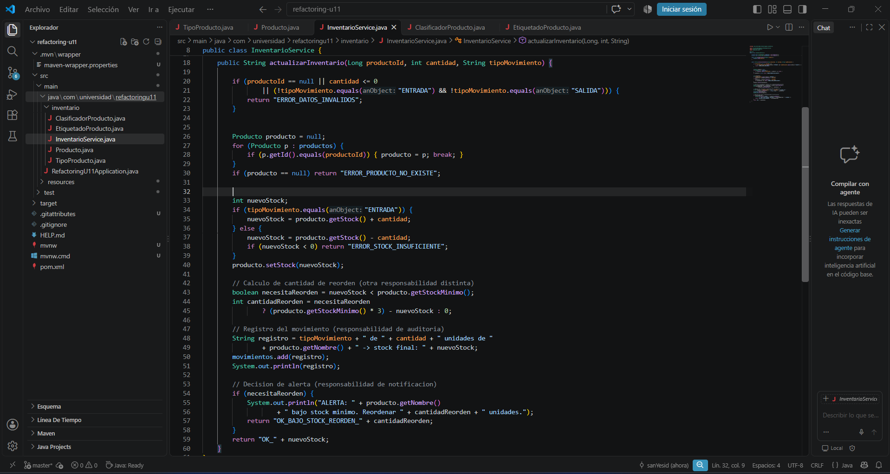 |
| *Switch Statements* duplicados en `ClasificadorProducto` y `EtiquetadoProducto` | 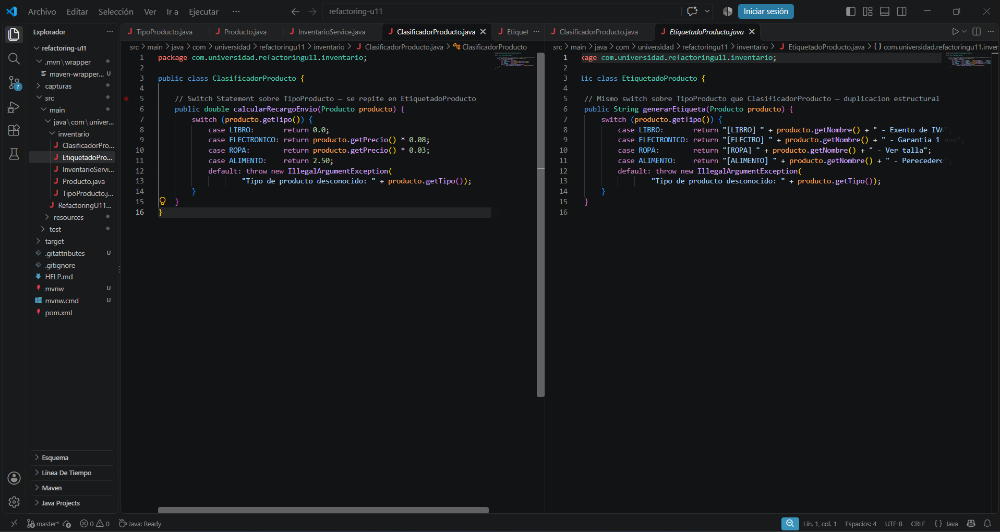 |
| Compilación del código original (`BUILD SUCCESS`) | 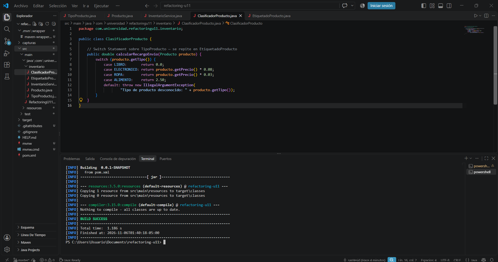 |

## 5. Paso 2 — Pruebas de caracterización (antes de tocar el código)

Se escribieron y ejecutaron **antes de modificar** cualquier clase de producción. Se instancian directamente (`new InventarioService()`), sin levantar el contexto de Spring, para que sean rápidas.

| Clase de prueba | Tests | Qué documenta |
| :--- | :---: | :--- |
| `InventarioServiceTest` | 6 | Entrada, salida válida, salida con stock insuficiente (sin modificar stock), reorden calculado (`3·mín − stock`), tipo de movimiento inválido y producto inexistente |
| `ClasificadorProductoTest` | 4 | Recargo de envío de las 4 ramas: `LIBRO` 0, `ELECTRONICO` 8 %, `ROPA` 3 %, `ALIMENTO` fijo 2.50 |
| `EtiquetadoProductoTest` | 4 | Etiqueta de las 4 ramas |
| **Total de pruebas de negocio** | **14** | |

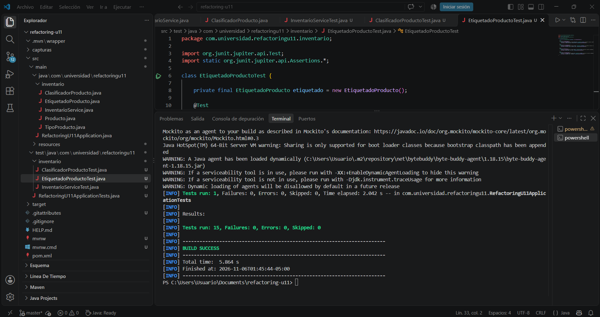

> **Nota sobre el conteo:** en las ejecuciones de la Parte 1 Maven reporta **15** tests: las 14 pruebas anteriores más `RefactoringU11ApplicationTests` (1 test de carga de contexto generado por Spring Initializr). Desde la Parte 2 (capturas 12 a 18) ese test ya no figura en el árbol de pruebas.

## 6. Paso 3 — Refactorización del *Long Method*

### 6.1. Diagnóstico

`actualizarInventario(Long, int, String)` abarcaba las líneas 18 a 60 (≈ **41 líneas de cuerpo**, contando comentarios y líneas vacías) y mezclaba **5 responsabilidades** en un único bloque:

1. Validación de parámetros de entrada.
2. Búsqueda secuencial del producto.
3. Cálculo y actualización del stock (con verificación de saldo en salidas).
4. Cálculo de la cantidad de reorden (`stockMinimo * 3 - nuevoStock`).
5. Registro de auditoría y decisión de alerta/retorno.

**Técnicas de Fowler aplicadas:** *Extract Method* + *Replace Nested Conditional with Guard Clauses*. Además se reemplazaron los literales `"ENTRADA"`, `"SALIDA"` y `3` por constantes (`MOVIMIENTO_ENTRADA`, `MOVIMIENTO_SALIDA`, `FACTOR_REORDEN`).

### 6.2. Resultado

```java
public String actualizarInventario(Long productoId, int cantidad, String tipoMovimiento) {
    if (!esMovimientoValido(productoId, cantidad, tipoMovimiento)) return "ERROR_DATOS_INVALIDOS";
    Producto producto = buscarProductoPorId(productoId);
    if (producto == null) return "ERROR_PRODUCTO_NO_EXISTE";
    if (!tieneStockSuficiente(producto, cantidad, tipoMovimiento)) return "ERROR_STOCK_INSUFICIENTE";

    int nuevoStock = aplicarMovimientoStock(producto, cantidad, tipoMovimiento);
    registrarMovimiento(producto, cantidad, tipoMovimiento, nuevoStock);
    return generarRespuestaActualizacion(producto, nuevoStock);
}
```

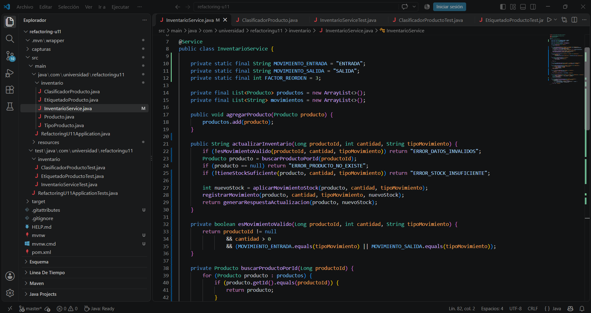

**Métodos privados extraídos (7), cada uno con una única responsabilidad:**

| Método | Responsabilidad |
| :--- | :--- |
| `esMovimientoValido(Long, int, String)` | Valida precondiciones de entrada |
| `buscarProductoPorId(Long)` | Localiza el producto en memoria |
| `tieneStockSuficiente(Producto, int, String)` | Verifica disponibilidad antes de descontar |
| `aplicarMovimientoStock(Producto, int, String)` | Calcula y actualiza el nuevo stock |
| `calcularCantidadReorden(Producto, int)` | Calcula las unidades a reordenar si cae bajo el mínimo |
| `registrarMovimiento(Producto, int, String, int)` | Trazabilidad de auditoría |
| `generarRespuestaActualizacion(Producto, int)` | Decide si hay alerta de reorden y formatea el código de retorno |

### 6.3. Evidencia antes / después

| Métrica | Antes | Después | Mejora |
| :--- | :--- | :--- | :--- |
| Líneas de cuerpo de `actualizarInventario()` | ≈ 41 (líneas 19–59) | **8** (líneas 22–29) | ≈ 80 % menos |
| Responsabilidades en `actualizarInventario()` | 5 mezcladas | **1** (orquestación) | Separadas en 7 métodos cohesivos (SRP) |
| Complejidad ciclomática de `actualizarInventario()` ¹ | 9 (12 contando `&&`/`\|\|`) | **4** (solo guard clauses planas) | Ramificación anidada eliminada |
| Complejidad ciclomática máxima de los métodos extraídos ¹ | — | ≤ 3 | Cada método es trivial de leer y probar |
| `InventarioServiceTest` | 6 en verde | **6 en verde, sin modificar** | Comportamiento observable preservado |

¹ Convención: CC = 1 + número de `if`, `for`, `?:` y `case`. La complejidad total no desaparece: **se reparte** en métodos pequeños, y la del método público baja de 9 a 4.

### 6.4. Decisión de diseño 1 — Reorden: ¿método privado o clase `CalculadoraReorden`?

**Decisión:** `calcularCantidadReorden(Producto, int)` se extrajo como **método privado dentro de `InventarioService`**, no como clase colaboradora.

**Justificación:**

1. **No tiene una razón de cambio propia y distinta.** La regla es una sola expresión (`stockMinimo * FACTOR_REORDEN - stockActual`, solo si `stockActual < stockMinimo`). Es política de inventario, la misma responsabilidad que ya tiene el servicio, y no existe todavía una segunda fuente de cambio (otro actor, otro proveedor, otra política) que la separe.
2. **Es pura y estable.** No tiene estado, no usa I/O ni depende de otros beans. Una clase aparte solo añadiría indirección: otro archivo, otro colaborador que construir o inyectar y otro punto de navegación para leer una línea.
3. **Respeta las pruebas existentes.** `InventarioServiceTest` hace `new InventarioService()` sin argumentos. Un colaborador obligatorio por constructor habría exigido tocar la firma que usan las pruebas de caracterización, y el refactor debe ser invisible para ellas.
4. **El número mágico quedó nombrado** (`FACTOR_REORDEN = 3`), lo que ya resuelve el problema de legibilidad sin crear una clase.

**Cuándo sí extraería `CalculadoraReorden`:** si la política dependiera de la categoría del producto, del tiempo de entrega del proveedor o de parámetros configurables; ahí tendría razón de cambio propia y convendría una estrategia/clase testeable de forma aislada.

## 7. Paso 4 — Refactorización del *Switch Statement* duplicado

### 7.1. Diagnóstico

`ClasificadorProducto.calcularRecargoEnvio(Producto)` y `EtiquetadoProducto.generarEtiqueta(Producto)` contenían exactamente la misma estructura `switch (producto.getTipo())` con las mismas 4 ramas (`LIBRO`, `ELECTRONICO`, `ROPA`, `ALIMENTO`) y el mismo `default`. Esa duplicación estructural provocaba *Shotgun Surgery*: agregar un tipo obligaba a modificar ambas clases (y el enum).

**Técnica de Fowler aplicada:** *Replace Conditional with Polymorphism*, mediante métodos abstractos que implementa cada constante del `enum TipoProducto`.

### 7.2. Resultado

```java
public enum TipoProducto {
    LIBRO {
        @Override public double calcularRecargoEnvio(double precio) { return 0.0; }
        @Override public String formatearEtiqueta(String nombreProducto) {
            return "[LIBRO] " + nombreProducto + " - Exento de IVA";
        }
    },
    ELECTRONICO { /* precio * 0.08 · "[ELECTRO] ... - Garantia 1 ano" */ },
    ROPA        { /* precio * 0.03 · "[ROPA] ... - Ver talla" */ },
    ALIMENTO    { /* 2.50 fijo     · "[ALIMENTO] ... - Perecedero" */ };

    public abstract double calcularRecargoEnvio(double precio);
    public abstract String formatearEtiqueta(String nombreProducto);
}

// Las firmas públicas se conservan intactas:
public double calcularRecargoEnvio(Producto producto) {
    return producto.getTipo().calcularRecargoEnvio(producto.getPrecio());
}
public String generarEtiqueta(Producto producto) {
    return producto.getTipo().formatearEtiqueta(producto.getNombre());
}
```

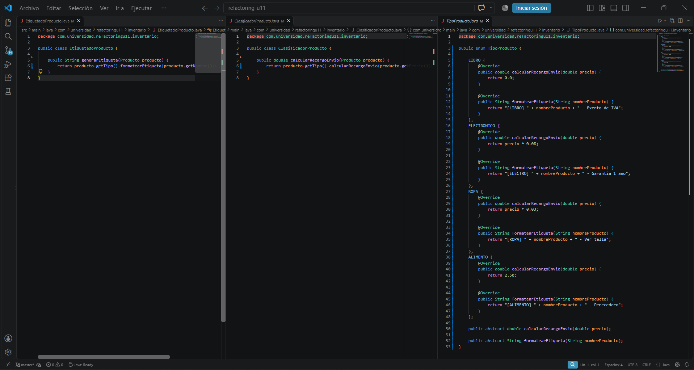

### 7.3. Evidencia antes / después

| Métrica | Antes | Después | Mejora |
| :--- | :--- | :--- | :--- |
| `switch` / `if-else` sobre `TipoProducto` | 2 bloques `switch` (4 `case` + `default` cada uno) | **0** | 100 % eliminados |
| Duplicación estructural del condicional | 100 % (misma estructura en 2 clases) | **0 %** (delegación de 1 línea) | Cumple Open/Closed en los consumidores |
| CC de `calcularRecargoEnvio` y `generarEtiqueta` | 5 en cada uno (10 en total) | **1** en cada uno (2 en total) | −80 % |
| Líneas de cada método | 9 (firma a llave de cierre) | **3** (firma, `return`, llave); 1 línea de lógica | Delegación directa |
| Clases a modificar al agregar un `TipoProducto` | 3 (`TipoProducto`, `ClasificadorProducto`, `EtiquetadoProducto`) | **1** (`TipoProducto`) | Fin del *Shotgun Surgery* |
| `ClasificadorProductoTest` / `EtiquetadoProductoTest` | 4 + 4 en verde | **4 + 4 en verde, sin modificar** | Firmas y comportamiento intactos |

### 7.4. Decisión de diseño 2 — ¿Enum con métodos abstractos o interfaz de estrategia?

**Decisión:** se convirtió `TipoProducto` en un **enum con un método abstracto por comportamiento** (una implementación por constante), en lugar de crear una interfaz `EstrategiaProducto` con una clase por tipo.

**Justificación:**

1. **El conjunto de tipos es cerrado y estable.** Son 4 valores del dominio que ya modelaba el enum. Un enum expresa exactamente eso: un conjunto finito y conocido.
2. **El compilador impone la completitud.** Si se agrega una constante y no se implementan ambos métodos abstractos, el código no compila. Con una jerarquía de estrategias habría que acordarse de crear la clase y registrarla; con el enum el error aparece en compilación.
3. **Menor costo estructural.** Una estrategia por tipo implicaría una interfaz más 4 clases (o beans) y un mecanismo de selección (mapa o `switch`), es decir, volver a introducir un condicional para elegir la estrategia.
4. **Los comportamientos son puros y sin estado.** Solo reciben datos (`precio`, `nombreProducto`) y devuelven un valor, por lo que no necesitan colaboradores.

**Contrapartida asumida:** un enum no puede recibir beans de Spring. Si en el futuro cada tipo necesitara colaboradores inyectados (servicio de impuestos, tarifas desde base de datos) o los tipos se volvieran configurables en tiempo de ejecución, convendría migrar a una interfaz de estrategia con beans y un `Map<TipoProducto, Estrategia>`. Mientras tanto, la complejidad adicional no se justifica.

## 8. Paso 5 — Resultado de `mvn test` antes y después de cada refactorización

| Momento | Comando | Tests | Fallos / Errores | Estado | Captura |
| :--- | :--- | :---: | :---: | :---: | :---: |
| **Paso 2:** red de seguridad sobre el código original | `mvn test` | 15 ¹ | 0 / 0 | `BUILD SUCCESS` | [04](capturas/04-paso2-mvn-test-antes.png) |
| **Paso 3:** tras eliminar el *Long Method* | `mvn test` | 15 ¹ | 0 / 0 | `BUILD SUCCESS` | [07](capturas/07-paso3-test.png) |
| **Paso 4:** tras eliminar los *Switch* con polimorfismo | `mvn test` | 15 ¹ | 0 / 0 | `BUILD SUCCESS` | [09](capturas/09-paso4-test.png) |

¹ 14 pruebas de caracterización (6 + 4 + 4) + 1 test de contexto de Spring Initializr. **Ninguna de las 14 pruebas de caracterización fue modificada** en ningún paso.

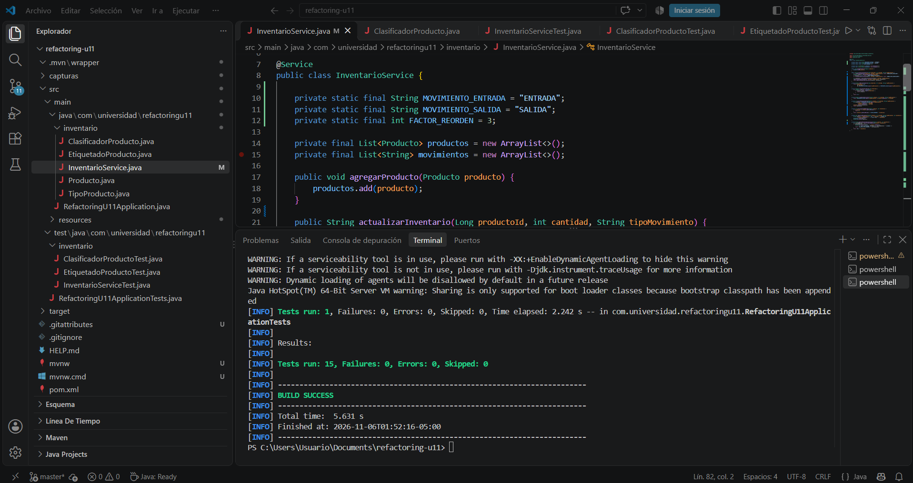
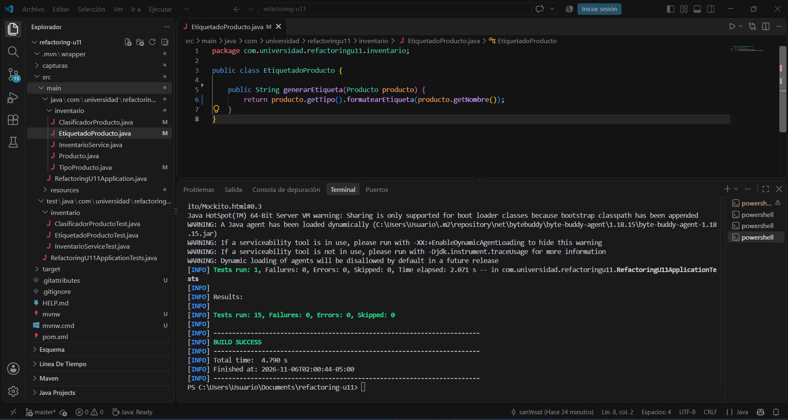

---

# Parte 2: Diagnóstico y resolución de acoplamiento entre paquetes

## 9. Objetivo de la Parte 2

Diagnosticar, con evidencia de una prueba de arquitectura, una dependencia cíclica entre dos paquetes, resolverla con inversión de dependencias y confirmar —re-ejecutando sin modificarlas las pruebas de la Parte 1— que el comportamiento no cambió.

## 10. Paso 1 — Módulo `reportes` y acoplamiento introducido

Se agregó ArchUnit 1.3.0 (alcance `test`) y el paquete `reportes` con `ReporteBajoStockService`. Para que el inventario le avise al módulo de reportes, `InventarioService` quedó con un setter opcional (`@Autowired(required = false)`) y un `import` directo a `reportes`.

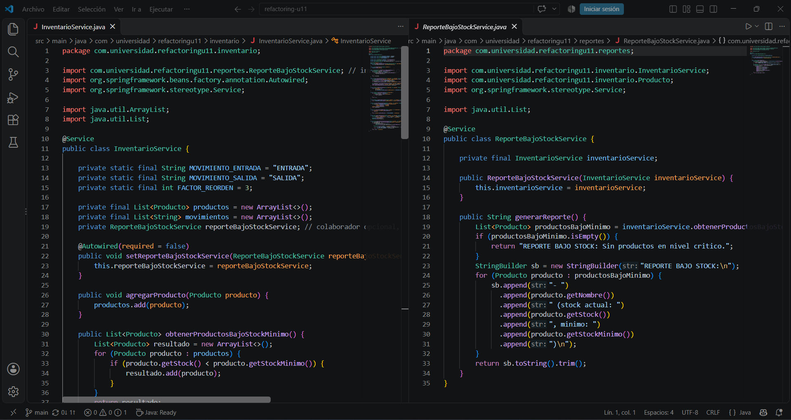

El proyecto compila y **las 14 pruebas de negocio siguen en verde**: el problema es de arquitectura, no de comportamiento.

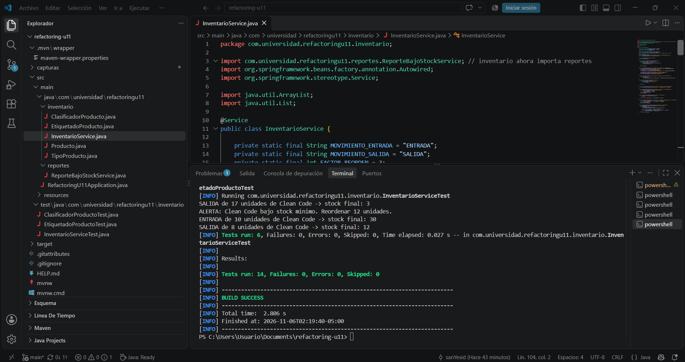

## 11. Paso 2 — Diagnóstico con ArchUnit (prueba en rojo)

```java
slices().matching("com.universidad.refactoringu11.(*)..")
        .should().beFreeOfCycles()
        .check(clases);
```

`mvn test -Dtest=ArquitecturaPaquetesTest` **falla** y ArchUnit reporta el ciclo (18 violaciones de arquitectura en 1 ciclo):

```text
Cycle detected: Slice inventario ->
                Slice reportes ->
                Slice inventario
  1. Dependencies of Slice inventario
    - Field <...inventario.InventarioService.reporteBajoStockService> has type <...reportes.ReporteBajoStockService>
    - Method <...InventarioService.setReporteBajoStockService(...ReporteBajoStockService)> has parameter of type <...ReporteBajoStockService>
    - Method <...InventarioService.generarRespuestaActualizacion(...)> calls method <...ReporteBajoStockService.generarReporte()> (InventarioService.java:96)
  2. Dependencies of Slice reportes
    - Constructor <...ReporteBajoStockService.<init>(...InventarioService)> has parameter of type <...InventarioService>
    - Method <...ReporteBajoStockService.generarReporte()> calls method <...InventarioService.obtenerProductosBajoStockMinimo()>
    - Method <...ReporteBajoStockService.generarReporte()> calls method <...Producto.getNombre() / getStock() / getStockMinimo()>
[ERROR] Tests run: 1, Failures: 1, Errors: 0, Skipped: 0
[INFO]  BUILD FAILURE
```

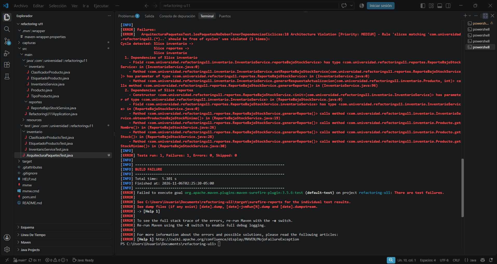

**Diagrama de paquetes ANTES (ciclo):**

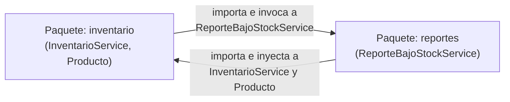

## 12. Paso 3 — Resolución: inversión de dependencias

Se extrajo la interfaz `NotificadorBajoStock` **en el paquete `inventario`**. `InventarioService` pasa a depender solo de esa abstracción, y `ReporteBajoStockService` (en `reportes`) la implementa:

```java
// inventario/NotificadorBajoStock.java
public interface NotificadorBajoStock {
    void notificar(Producto producto, int cantidadReorden);
}

// inventario/InventarioService.java  → ya no importa nada de reportes
private NotificadorBajoStock notificador;

@Autowired(required = false)
public void setNotificador(NotificadorBajoStock notificador) { this.notificador = notificador; }

// reportes/ReporteBajoStockService.java
public class ReporteBajoStockService implements NotificadorBajoStock { ... }
```

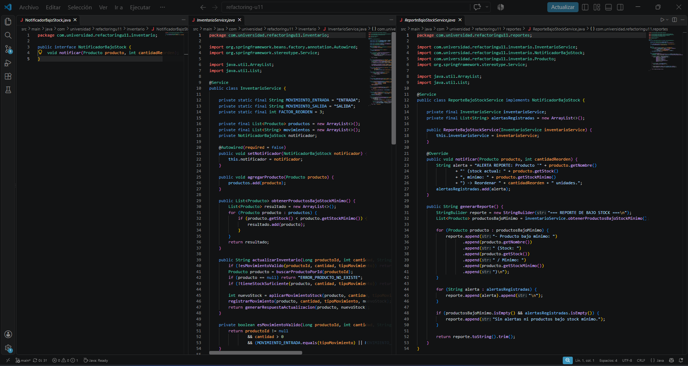

`ArquitecturaPaquetesTest` pasa en verde:

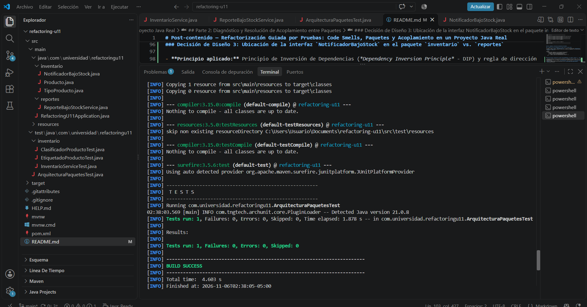

**Diagrama de paquetes DESPUÉS (sin ciclo):**

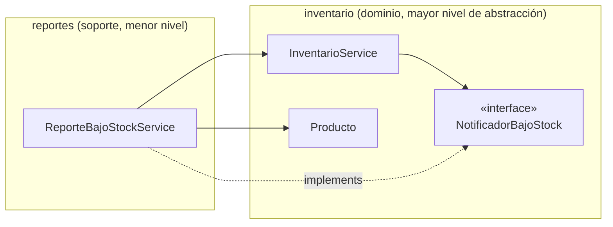

Todas las flechas **entre paquetes** apuntan en una sola dirección: `reportes → inventario`.

### 12.1. Decisión de diseño 3 — Ubicación de `NotificadorBajoStock`: `inventario` y no `reportes`

- **Principio aplicado:** Inversión de Dependencias (DIP) y la regla de dirección entre capas: *los paquetes de infraestructura/soporte dependen del dominio; el dominio nunca depende de infraestructura*.
- **Decisión:** la interfaz vive en `com.universidad.refactoringu11.inventario`.
- **Justificación:**
  1. **Nivel de abstracción y propiedad del contrato.** `inventario` es el paquete de mayor nivel: encapsula las entidades y reglas esenciales (`Producto`, `TipoProducto`, control de existencias, cálculo de reorden). `reportes` es un consumidor secundario que formatea salidas a partir del estado del inventario. Quien necesita ser notificado (el dominio) es quien define el contrato.
  2. **Ubicarla en `reportes` no rompería el ciclo.** `InventarioService` tendría que seguir importando `reportes.NotificadorBajoStock` y `reportes` seguiría importando `InventarioService` y `Producto`. La unidad de acoplamiento entre paquetes son los tipos importados, así que el ciclo detectado por ArchUnit seguiría vivo.
  3. **Inversión real de la flecha.** Con la interfaz en `inventario`, el dominio declara qué necesita sin saber quién lo implementa, y `reportes` implementa ese contrato dependiendo de `inventario` en la única dirección permitida.

## 13. Paso 4 — Las pruebas de la Parte 1 siguen en verde, sin modificarse

Con el ciclo resuelto se ejecutó la suite completa **sin cambiar una sola línea** de `InventarioServiceTest`, `ClasificadorProductoTest` ni `EtiquetadoProductoTest`:

| Clase de prueba | Tests | Resultado |
| :--- | :---: | :---: |
| `ArquitecturaPaquetesTest` | 1 | verde |
| `ClasificadorProductoTest` | 4 | verde |
| `EtiquetadoProductoTest` | 4 | verde |
| `InventarioServiceTest` | 6 | verde |
| **Total** | **15** | `Failures: 0, Errors: 0` · `BUILD SUCCESS` |

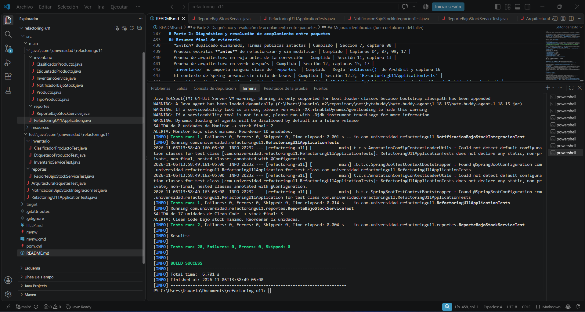
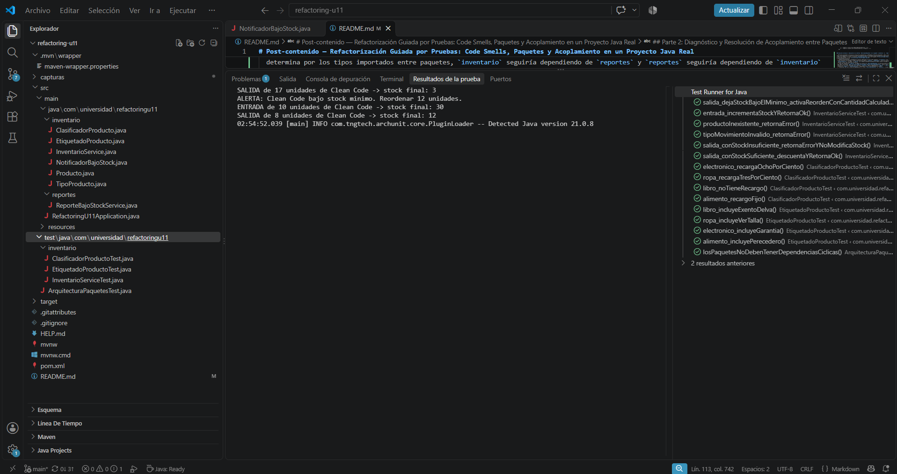

### 13.1. Decisión de diseño 4 — Granularidad de `NotificadorBajoStock`: evento individual vs. lote

- **Firma elegida:** `void notificar(Producto producto, int cantidadReorden);` (evento individual).
- **Alternativa analizada:** `void notificar(List<Producto> productosBajoStock);` (lote).
- **Justificación:**
  1. **Reactividad e intención del dominio (*Domain Events*).** `actualizarInventario()` procesa un movimiento en tiempo real. Emitir `(Producto, cantidadReorden)` en el instante en que se cruza el umbral permite que los consumidores (el reporte, un correo, un webhook de aprovisionamiento) reaccionen de inmediato, sin esperar a un cierre global.
  2. **Contexto transaccional encapsulado.** El evento lleva exactamente el producto afectado y la cantidad ya calculada: el inventario no tiene que escanear todos los productos y el notificador no tiene que recalcular el reorden.
  3. **Cuándo preferiría el lote.** En procesos *batch* o tareas programadas (cierre diario, consolidación semanal de compras a proveedores): enviar una lista única reduce I/O de red, amortiza llamadas a servicios externos y evita la *alert fatigue* de miles de notificaciones aisladas en un pico de ventas.

---

## Resumen final de evidencia

| Criterio | Estado | Evidencia |
| :--- | :---: | :--- |
| *Long Method* eliminado (≤ 10 líneas, responsabilidades separadas) | Cumplido | Captura 06 |
| *Switch* duplicado eliminado, firmas públicas intactas | Cumplido | Captura 08 |
| Pruebas escritas **antes** de refactorizar y sin modificar | Cumplido | Capturas 04, 07, 09, 17 |
| Prueba de arquitectura en rojo antes de la corrección | Cumplido | Captura 13 |
| Prueba de arquitectura en verde después | Cumplido | Capturas 15, 17 |
| `inventario` no importa ninguna clase de `reportes` | Cumplido | Captura 16 (imports de `InventarioService`) |
| Decisiones de diseño 1, 2, 3 y 4 documentadas | Cumplido | Secciones 6.4, 7.4, 12.1, 13.1 |

## Mejoras identificadas (fuera del alcance del taller)

Quedaron fuera para no mezclar refactorización con cambios de comportamiento, pero son los siguientes pasos naturales:

- **Pruebas faltantes:** `cantidad <= 0`, `productoId == null`, `tipoMovimiento == null`, stock igual al mínimo (frontera de `<`) y verificación de que `NotificadorBajoStock.notificar(...)` se invoca solo cuando corresponde (con una implementación lambda). `ReporteBajoStockService` no tiene pruebas.
- **Salida estándar:** reemplazar `System.out.println` por un *logger* (SLF4J).
- **Tipos primitivos obsesivos (*Primitive Obsession*):** `tipoMovimiento` como `String` y los códigos de retorno como `String` podrían ser un `enum TipoMovimiento` y un `ResultadoActualizacion`; el dinero como `double` podría ser `BigDecimal`.
- **Encapsulación:** `Producto.setStock(int)` es público; operaciones como `aplicarEntrada`/`aplicarSalida` protegerían el invariante de stock no negativo.
- **Nombre y efectos de `generarRespuestaActualizacion`:** además de formatear el retorno, notifica e imprime. Extraer `notificarBajoStock(...)` dejaría cada método con un solo motivo de cambio.
- **`ReporteBajoStockService`:** `alertasRegistradas` crece sin límite y nunca se limpia (un producto repuesto seguiría apareciendo en alertas viejas) y no es seguro ante concurrencia.
